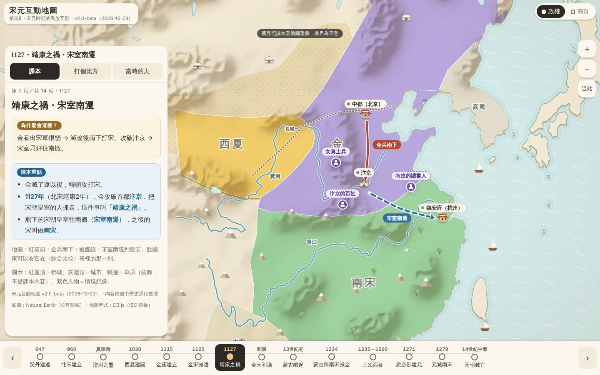
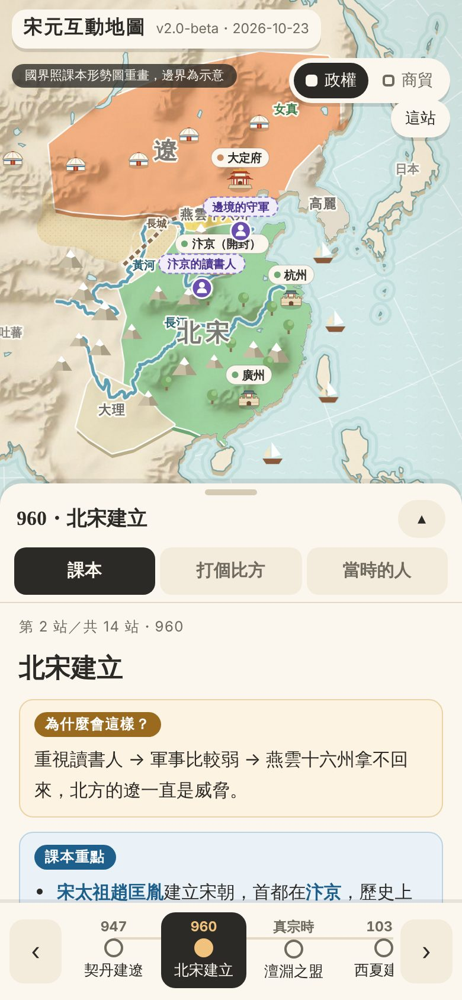
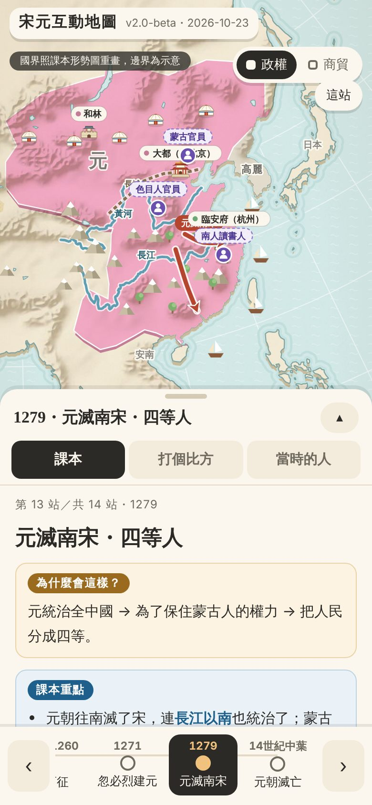
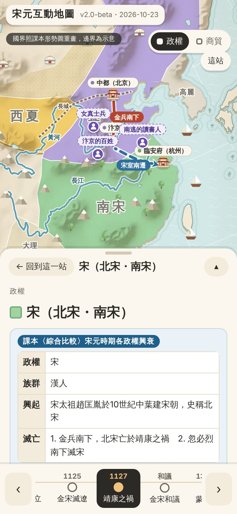

# 宋元互動地圖

一個媽媽為了陪國中女兒複習歷史，做出來的互動地圖。

做好拿給女兒看，她說：「好無聊。我都背起來了，這不就跟課本一樣嗎？」

……好吧。所以加了兩個小遊戲，放上來送給還沒背起來的同學。

👉 **線上直接玩：https://mochachen1225-create.github.io/song-yuan-map/**

## 裡面有什麼

- **14 站時間軸**：從契丹建遼一路到元朝滅亡，國界跟著年代淡入淡出地變化
- **每站三個頁籤**
  - **課本**：為什麼會這樣、重點整理，還有「課外補充，不用背」的冷知識卡片
  - **打個比方**：用生活裡的例子幫你理解
  - **當時的人**：聽聽皇帝、士兵、讀書人、老百姓怎麼想（情境想像，不用背）
- **兩個圖層**
  - **政權**：點國家可以看各政權的比較表
  - **商貿**：海路、陸路、市舶司、驛站……地點會跟著時間軸出現
- **兩個小遊戲**（見下面）

不用安裝，也不用網路：下載 `index.html`，用瀏覽器打開就能用。手機、電腦都可以。

## 怎麼玩

### 地圖
- 下方時間軸點一站，或按 ‹ ›；手機在說明卡上左右滑也能換站
- 拖曳移動地圖，滾輪或兩指縮放；按「這站」回到這一站的範圍
- 手機的說明卡可以往上拉大、往下收小
- 網址後面加站名可以直接打開那一站，例如 `#s1127`（靖康之禍）

### 🎯 小遊戲一：回回砲打襄陽
直接玩：https://mochachen1225-create.github.io/song-yuan-map/#trebuchet
（或在第 12 站「1271 忽必烈建元」的回回砲卡片按「試試看」）

1. 選「人拉的投石機」或「回回砲（配重）」
2. 拉滑桿調角度，按「發射！」
3. 人拉的投石機力氣不夠，怎麼調都打不到；回回砲角度調對了，打中三次城牆就破

> 遊戲裡的遠近是誇張過的，不是真實距離。史實只有：襄陽被圍將近 5 年，回回砲出現後才被打下來。

### ⛵ 小遊戲二：泉州海商下南洋
直接玩：https://mochachen1225-create.github.io/song-yuan-map/#voyage
（或打開「商貿」圖層，點「海路貿易」或「泉州・市舶司」卡片）

1. 你是南宋泉州的海商，要開船到三佛齊（今天的蘇門答臘一帶）做生意
2. **出發前準備**：勾選要帶什麼（有一個是陷阱選項）
3. **選季節**：夏天還是冬天出海？
4. **開船**：點一下海圖，船就開過去；也可以按住拖著走。右上角可以加速
5. 路上會遇到礁石、陰天；到港後還要選對季節才能回家

> 海岸線是真實的；風、雲、礁石的位置和船速是為了遊戲簡化過的。每一關的說明都附出處。

## 素材和資料來源

### 地圖與程式
| 項目 | 來源 | 授權 |
|---|---|---|
| 海岸線、湖泊、黃河、長江、沙漠、山脈範圍 | [Natural Earth](https://www.naturalearthdata.com/) 1:50m | 公有領域 |
| 山脈陰影 | 用上面 Natural Earth 的山脈、高原範圍自己算出來的（不是高程資料） | 衍生自公有領域資料 |
| 地圖程式 | [D3.js](https://d3js.org/) v7.9.0（已內嵌在 HTML 裡） | ISC |
| 國界形狀 | 依國中歷史課程的形勢圖重畫的示意，**不是精確的歷史邊界** | 本專案 |
| 圖示、插圖 | 本專案自己畫的 SVG | 本專案 |

沒有使用任何歷史國界資料集。

### 內容
- **課本、表格**：依國中歷史課程（宋元時期的民族互動）整理，用自己的話改寫
- **打個比方、當時的人**：幫助理解的想像，不是史實
- **課外補充卡片和小遊戲**：每一則都附出處，主要有：
  - 史料：趙汝适《諸蕃志》、周去非《嶺外代答》、朱彧《萍洲可談》、義淨《南海寄歸內法傳》、北宋元祐年間的市舶法
  - 文物與遺址：泉州九日山宋代祈風石刻、1974 年泉州灣出土的宋代海船、「南海一號」南宋沉船
  - 年代：廣州市舶司 971 年、泉州市舶司 1087 年設立等，查證過的才寫

發現錯誤嗎？歡迎開 [Issue](https://github.com/mochachen1225-create/song-yuan-map/issues) 告訴我。如果你家小孩用了也覺得無聊，也歡迎告訴我哪裡無聊 XD

## 給想改程式的人
- 全部內容在一個 `index.html` 裡：資料在 `window.MAP_DATA`，程式在後面的 `<script>`
- 內嵌的 D3 和底圖由 `tools/build.sh` 產生：`cd tools && npm i && ./build.sh`（需要 node、python3 + Pillow、numpy）
- 開發紀錄和還沒做的想法在 [NOTES.md](NOTES.md)
