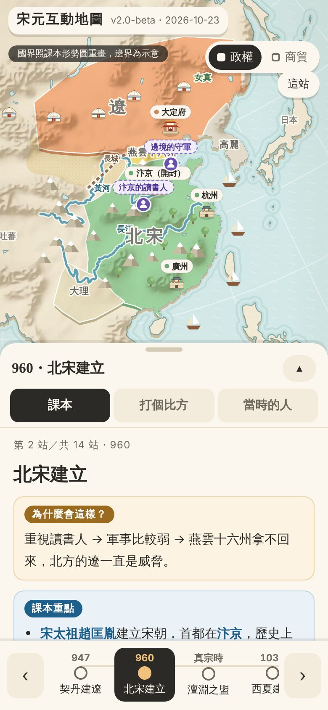
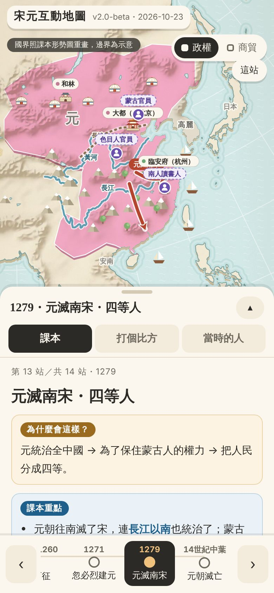
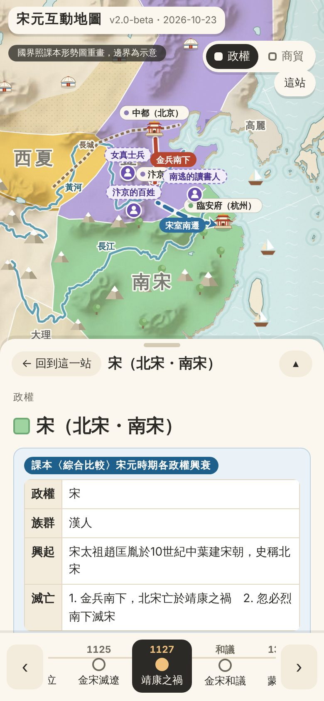

# 宋元互動地圖

一個媽媽為了陪國中女兒複習歷史，做出來的互動地圖。

做好拿給女兒看，她說：「好無聊。我都背起來了，這不就跟課本一樣嗎？」

……好吧。所以把它放上來，送給還沒背起來的同學。

👉 **線上直接玩：https://mochachen1225-create.github.io/song-yuan-map/**

## 裡面有什麼

- **14 站時間軸**：從契丹建遼一路到元朝滅亡，國界會跟著年代淡入淡出地變化
- **每站三個頁籤**
  - 課本：為什麼會這樣、重點整理
  - 打個比方：用生活裡的例子幫你理解
  - 當時的人：聽聽皇帝、士兵、讀書人、老百姓怎麼想（情境想像，不用背）
- **兩個圖層**：政權、商貿（海上絲路、陸路驛站）
- **點國家**：看各政權的比較表
- 手機可以左右滑換站、兩指縮放拖曳
- **兩個小遊戲**（每一關的說明都附出處）
  - 🎯 回回砲打襄陽：https://mochachen1225-create.github.io/song-yuan-map/#trebuchet
  - ⛵ 泉州海商下南洋（季風、指南針、水密隔艙）：https://mochachen1225-create.github.io/song-yuan-map/#voyage

不用安裝，也不用網路：下載 `index.html`，用瀏覽器打開就能用。

## 給想用的人

- 內容依國中歷史課程（宋元時期的民族互動）整理，**國界是依課程形勢圖重畫的示意，不是精確的歷史邊界**。
- 「打個比方」和「當時的人」是幫助理解的想像，不是史實。
- 如果你家小孩用了也覺得無聊，歡迎開 Issue 告訴我哪裡無聊 XD

## 資料和授權

- 底圖：[Natural Earth](https://www.naturalearthdata.com/) 1:50m（公有領域）
- 地圖程式：[D3.js](https://d3js.org/) v7.9.0（ISC 授權，已內嵌在 HTML 裡）
- 重新產生內嵌的底圖：`cd tools && npm i && ./build.sh`
