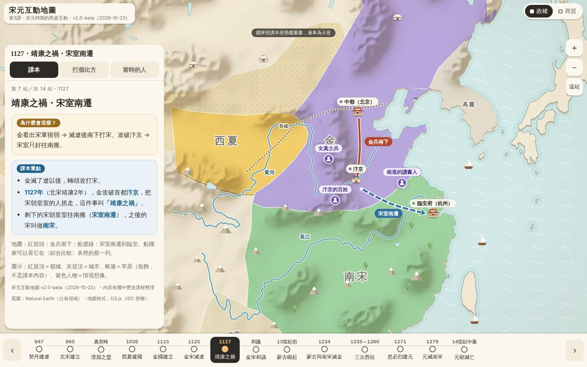

# 宋元互動地圖

給國中生複習「宋元時期的民族互動」的互動地圖。單一 HTML 檔，下載 `index.html` 後直接用瀏覽器打開就能用（不用網路），手機和電腦都可以。

- 14 站時間軸，每站有「課本」「打個比方」「當時的人」三個頁籤
- 政權、商貿兩個圖層；點政權可以看各政權的比較表
- 手機上可以左右滑換站、兩指縮放拖曳

## 資料和授權

- 底圖：[Natural Earth](https://www.naturalearthdata.com/) 1:50m（公有領域）
- 地圖程式：[D3.js](https://d3js.org/) v7.9.0（ISC 授權，已內嵌）
- 國界是依課程內容的形勢圖重畫的示意，不是精確的歷史邊界

重新產生內嵌的底圖：`cd tools && npm i && ./build.sh`
